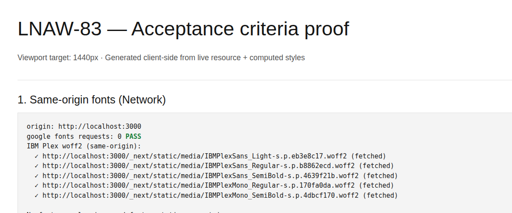
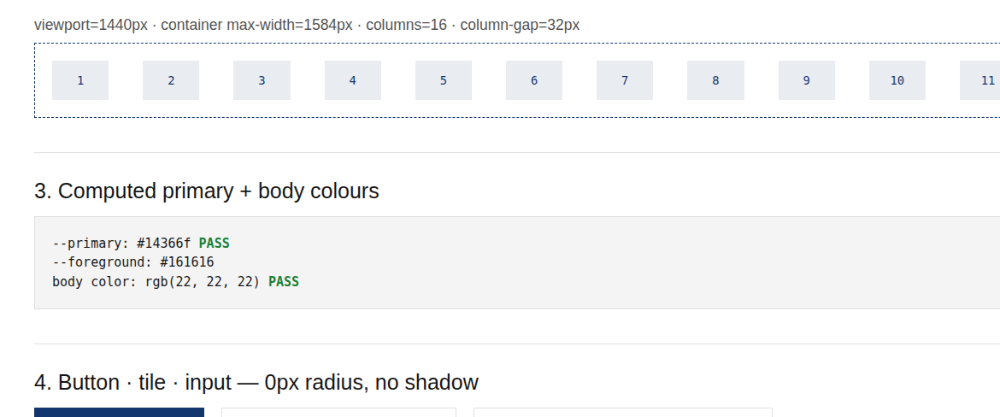
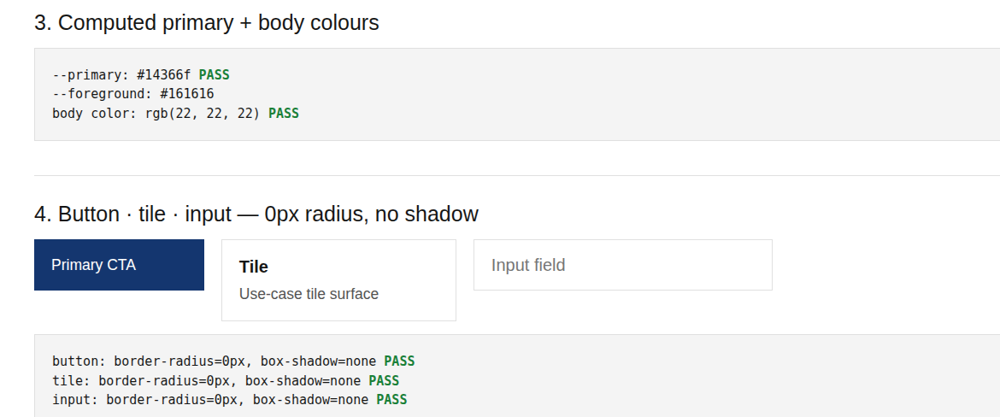
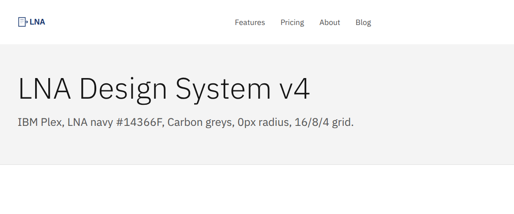

## Summary

**LNAW-83** — Website v4 design tokens and theme (IBM Plex self-hosted, LNA navy `#14366F`, Carbon greys, 0px radius, 16/8/4 grid).

Foundation + full chrome adaptation for the v4 redesign. Targets integration branch **`website-v4`** (not `main`). Draft for review only — do not merge until approved.

## Acceptance criteria proof

Live client capture at **1440×900** (`/lnaw-83-ac-proof.html` + `/en/design-system`). Machine-readable dump: [`computed-evidence.json`](./computed-evidence.json).

### 1. Same-origin fonts (no Google Fonts)

- Google Fonts requests: **0 PASS**
- IBM Plex woff2 served from same origin (`/_next/static/media/IBMPlex*.woff2`)
- No `fonts.googleapis.com` / `fonts.gstatic.com`

### 2. 1440px grid — 16 cols · 32px gutters · max-width 1584px

- `viewport=1440px · container max-width=1584px · columns=16 · column-gap=32px`

### 3. Computed primary + body colours

Same screenshot as above:

- `--primary: #14366f` **PASS**
- `--foreground: #161616` / `body color: rgb(22, 22, 22)` **PASS**

### 4. Button, tile, input — 0px radius, no shadow

- button / tile / input: `border-radius=0px`, `box-shadow=none` **PASS**

### 5. Hero display type — Plex Sans 300 ~54/64

- Live computed on home/design-system hero: **54px / weight 300 / line-height 64px** (IBM Plex Sans self-hosted)

## Test plan

- [ ] Open `/en` and `/en/design-system` at 1440px
- [ ] Open `/lnaw-83-ac-proof.html` and confirm all five sections still PASS
- [ ] Network tab: only same-origin `IBMPlex*.woff2` (no Google Fonts)
- [ ] Spot-check Features / Pricing / About / Blog / Contact chrome
- [ ] `npm run build` succeeds

## Notes

- Base branch: **`website-v4`** (v4 tickets collect here; redesign ships as one piece).
- `OFL.txt` is **not** included in this PR (license retained locally under `src/fonts/` if needed; fonts are SIL OFL).
- Do **not** merge to `main` from this PR.
